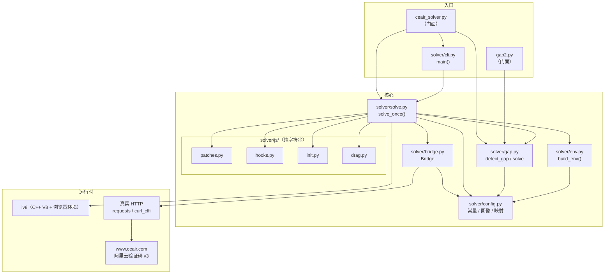
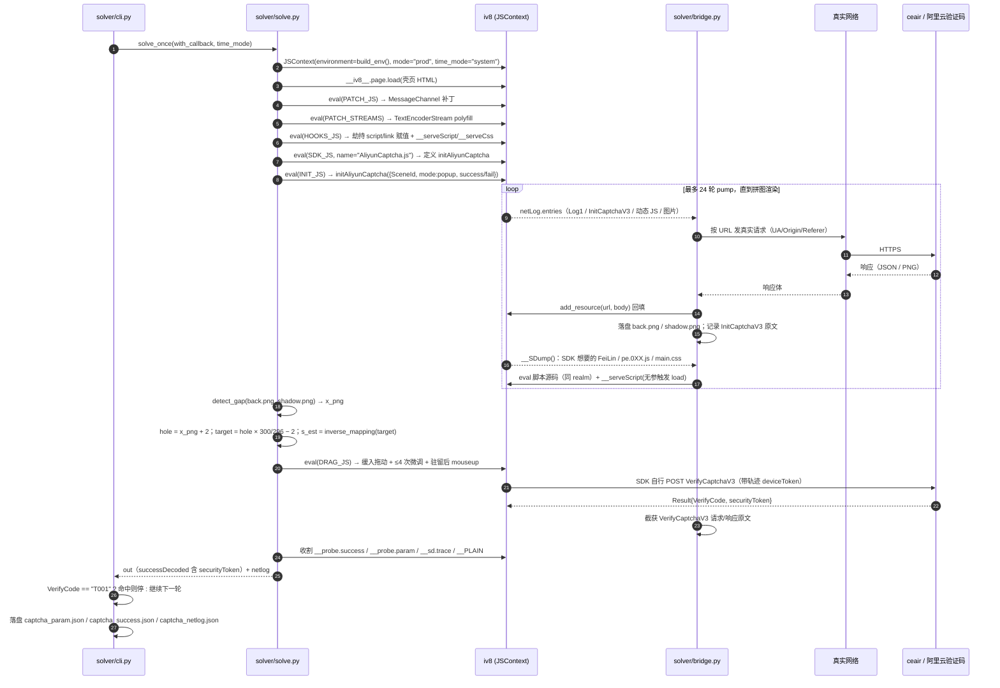
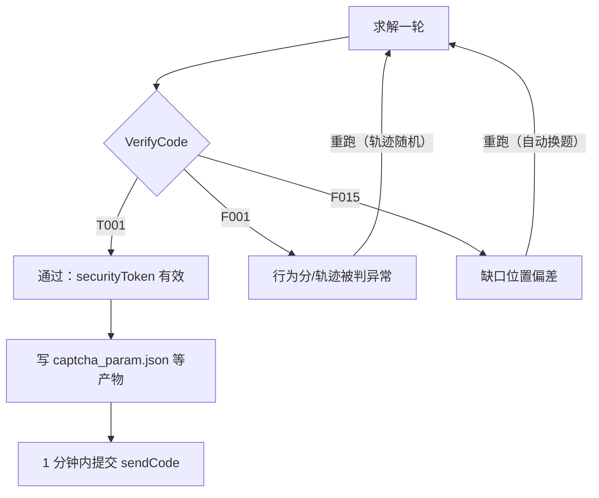
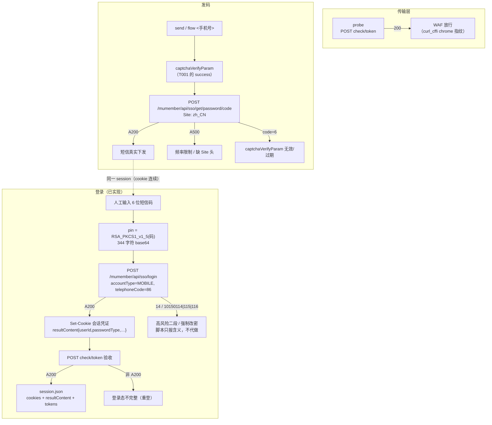
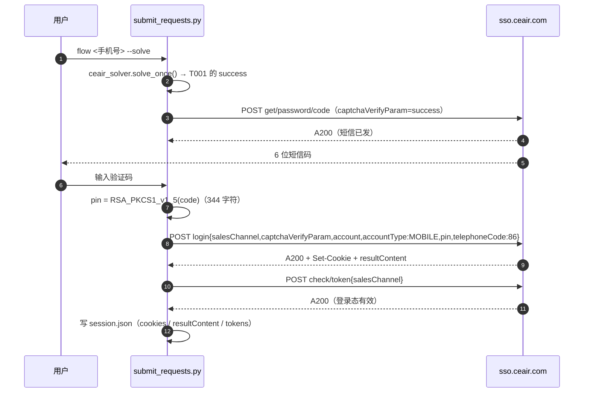

# 架构与流程（ceair 滑块求解器）

> 这份文档回答三个问题：**代码怎么分层**、**一次求解到底发生了什么**、**要改某件事该动哪个文件**。
> 图用 Mermaid 写，GitHub / VS Code / Typora 可直接渲染。

## 1. 分层原则

1. **配置 / 逻辑 / 文案分离**：站点常量、浏览器画像、几何映射全在 `solver/config.py`；注入 JS 全是纯字符串（`solver/js/`），不含 Python 逻辑；流程代码只调用、不硬编码。
2. **协议顺序在 `solve.py` 一处可见**：从 `page.load` 到收割参数是固定顺序，读一个函数就能看完整个协议，不用跨文件拼。
3. **入口不动**：`ceair_solver.py` / `gap2.py` 保留为兼容门面，既有命令与 `tools/` 的 `import` 全部照旧。
4. **等价优先于"更优雅"**：`detect_gap`（生产）与 `gap2.solve`（诊断）数学同源但故意不合并——两者边界处理不同，合并会改变已标定的求解结果。

## 2. 模块划分

| 文件 | 职责 | 不该放什么 |
|---|---|---|
| `ceair_solver.py` | **兼容门面**：重导出公共 API + `__main__` | 任何实现 |
| `gap2.py` | **诊断门面**：`gap2.solve` 离线看打分表 + `__main__` | 任何实现 |
| `solver/config.py` | 站点配置（URL/SceneId/prefix/region）、UA、浏览器画像 `MACHINE`（通用默认值，CEAIR_* 可覆盖）、几何映射 `MAPPING_A/B`、偏移与缩放、SDK 源码、壳页 HTML | 流程控制 |
| `solver/env.py` | 把画像拼成 iv8 的 `environment`（location/navigator/document/window/screen） | 判定、计算 |
| `solver/js/patches.py` | iv8 能力补丁：`MessageChannel` 端口、`TextEncoderStream` 段错误规避 | 站点相关逻辑 |
| `solver/js/hooks.py` | 页面钩子：捕获动态 script/link、同 realm eval 注入、**无参**触发 load、轨迹明文侧录 | Python 侧判断 |
| `solver/js/init.py` | `initAliyunCaptcha` 参数模板（默认不挂 `captchaVerifyCallback`） | 网络 |
| `solver/js/drag.py` | 人类式拖动：缓入曲线 + 微调闭环 + 收尾驻留 | 缺口识别 |
| `solver/gap.py` | 缺口识别 `detect_gap`（生产）/ `solve`（诊断）/ `inverse_mapping`（xPos→位移反解） | 网络、DOM |
| `solver/bridge.py` | `netLog` ↔ 真实 HTTP 的四步握手；落盘 `back.png`/`shadow.png`；记录 `InitCaptchaV3`/`VerifyCaptchaV3` 原文 | 判定逻辑 |
| `solver/solve.py` | 一次求解的主流程（顺序即协议） | 参数解析 |
| `solver/cli.py` | 参数解析、轮次重试、`VerifyCode` 判定、产物落盘 | 协议细节 |

### 依赖关系



## 3. 一次求解的完整时序



## 4. 判决与重试



> 实测：`T001` 通常 1–3 轮内出现；`F001`/`F015` 属**判决结果**而非程序异常，`--until-t001=N` 会自动重试。

## 5. 提交与登录链路（`submit_requests.py`）



- **已实测通过（2026-10-18）**：滑块 → `securityToken`、发码 `A200`、WAF 通行、登录（RSA pin）`A200` → `check/token` `A200` → `session.json`（`tokenKey` 与 3 个同值 cookie）。
- 仍自动化不了：读短信（必须人工输入 6 位码）；服务端二段风控（`14`/`15`/`10150114`）只报码不代办。
- 会话形态：凭证以 **cookie** 为主（`session.json` 存全量 cookie + `resultContent` 里命中 `token|ticket|sess|auth` 的字段），`status` 子命令用同一 cookie 复查。

### 登录时序



## 6. 要改某件事，动哪个文件

| 需求 | 改这里 | 注意 |
|---|---|---|
| 换目标站 / SceneId / prefix | `solver/config.py` | 同时确认 `SUCCESS` 判定与站点 bundle 的初始化参数 |
| 换浏览器画像（核数/内存/触屏/屏幕/窗口） | `solver/config.py` 的 `MACHINE`，或环境变量 `CEAIR_UA/CORES/MEM/TOUCH/SCREEN/WIN` | 画像改变会影响指纹一致性 |
| 重标定 `xPos ↔ slidePos` | `solver/config.py` 的 `MAPPING_A/B`、`PIECE_CANVAS_OFFSET`、`IMG_DISPLAY_SCALE` | 必须与 `docs/ceair_captcha_report.md` 的几何测量一起更新 |
| 调拖动轨迹（通过率） | `solver/js/drag.py` | 曲线/停顿/微调次数；改完跑 `--until-t001=3` 看命中率 |
| 换缺口识别算法 | `solver/gap.py` 的 `detect_gap`（生产路径） | 不要动 `solve`（诊断），否则历史打分表不可比 |
| 补 iv8 缺失 API | `solver/js/patches.py` | 只补宿主能力，不碰 SDK 源码 |
| 补风控二段 / 其它登录分支 | `submit_requests.py` 的 `cmd_login()`（错误码表） | 现有：MOBILE 动态码；`14` 二段需追加 `verifyCode + codeDestination` |

## 7. 等价性怎么验

重构前后逐项比对，脚本在 `tools/verify_refactor.py`（默认取 `_backup/ceair-*` 里最新的备份）：

```bash
.venv\Scripts\python.exe tools\verify_refactor.py
# 或指定备份： --backup ..\_backup\ceair-20261018-213854
```

核心断言：

1. 17 个模块常量（含 5 段注入 JS）与备份版**逐字节一致**；
2. `build_env()` / `build_env(cookie)` 字典相等；
3. `inverse_mapping()` 在 10 个采样点相等；
4. `detect_gap()` 对 `back.png`/`shadow.png` 输出相同（最近一次：x=178）；
5. `gap2.solve()` 分数表长度与首项相同（178 / 246 项 / 0.462147）；
6. `py_compile` 覆盖 `solver/**` + 门面 + `tools/*.py` 共 87 个文件。

回归另跑真实链路：`python ceair_solver.py --until-t001=3` → 命中 `T001`，`securityToken` 128 字符
（`F015`/`F001` 是缺口偏差/行为分的**判决结果**，属正常重试范围，不是程序异常）。
